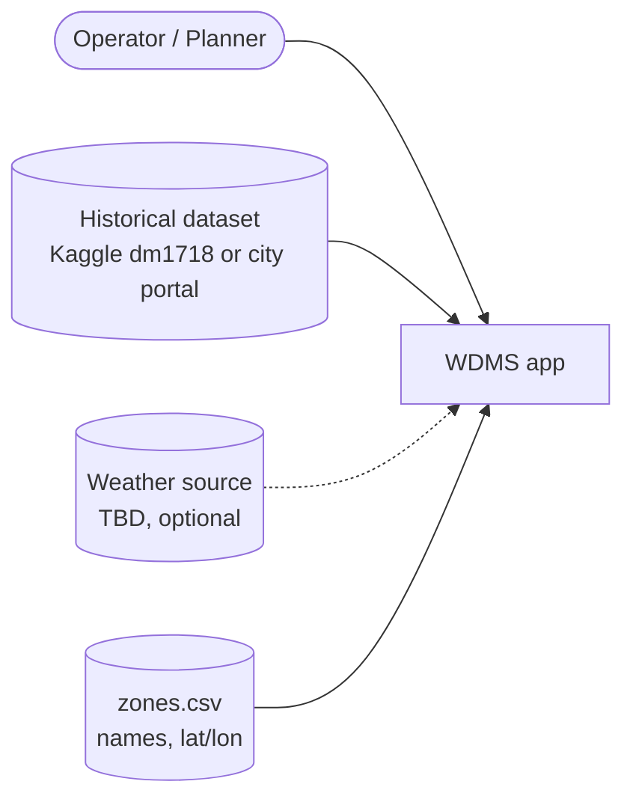
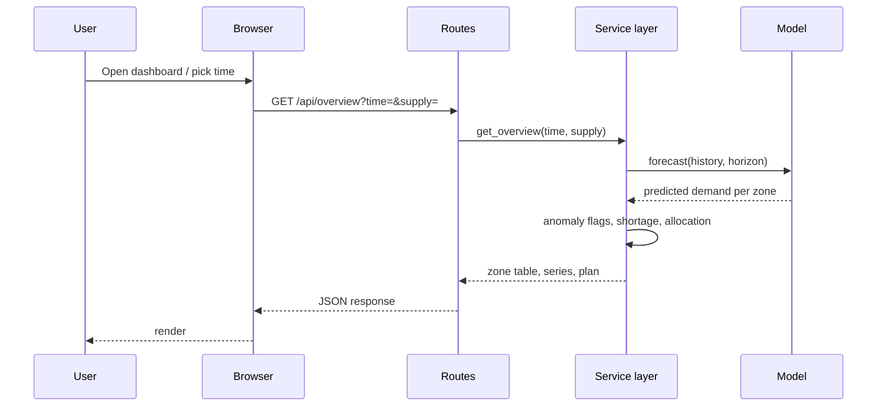

# System Architecture

> **Status:** Draft v0.1. This describes the **proposed** architecture. No code exists yet.
> Diagrams must be updated when the repository structure is created.

Related: [PRD.md](PRD.md) · [TECH_SPEC.md](TECH_SPEC.md) · [AGENTS.md](AGENTS.md)

## Contents

1. [Overview and principles](#1-overview-and-principles)
2. [System context](#2-system-context)
3. [High-level diagram](#3-high-level-diagram)
4. [Components](#4-components)
5. [Data flow](#5-data-flow)
6. [Storage](#6-storage)
7. [Boundaries and security](#7-boundaries-and-security)
8. [Errors and resilience](#8-errors-and-resilience)
9. [Deployment](#9-deployment)
10. [Decisions and trade-offs](#10-decisions-and-trade-offs)
11. [Limitations and future evolution](#11-limitations-and-future-evolution)

## 1. Overview and principles

- **One process, clear modules.** A hackathon-scale system does not need services.
- **Pure core.** Forecast, anomaly, shortage and allocation logic are pure functions on DataFrames, independent of the UI, so they are testable.
- **Offline training, online inference.** Models are trained by a script and loaded by the app.
- **Explainable outputs.** Every flag and recommendation shows the numbers behind it.

## 2. System context

External inputs are files or one optional weather lookup. WDMS has no outbound control actions.

## 3. High-level diagram

```mermaid
flowchart TB
    subgraph Offline[Offline pipeline: scripts]
        RAW[(data/raw)] --> ING[Ingest and validate]
        ING --> FE[Feature builder]
        FE --> TRN[Train and evaluate]
        TRN --> MODEL[(models/)]
        ING --> PROC[(data/processed)]
    end
    subgraph App[Flask app]
        WEB[Templates, JS, routes] --> SVC[Service layer]
        SVC --> FC[Forecast]
        SVC --> AN[Anomaly and surge]
        SVC --> SH[Shortage]
        SVC --> AL[Allocation]
    end
    MODEL --> FC
    PROC --> SVC
    SUPPLY([User supply input]) --> WEB
```

## 4. Components

| Component | Responsibility | PRD |
|---|---|---|
| Ingest and validate | Load files, normalize to the canonical schema, report data-quality issues | PRD-001 |
| Feature builder | Time, lag, rolling and weather features without leakage | PRD-003 |
| Forecast | Train, evaluate, persist, and predict per-zone demand | PRD-002, PRD-014 |
| Anomaly and surge | Residual scoring and surge flag | PRD-004, PRD-005 |
| Shortage | Compare demand and supply, assign risk | PRD-006, PRD-007 |
| Allocation | Compute the redistribution plan | PRD-008, PRD-010 |
| Service layer | Orchestrate the above for the UI; own caching | all |
| UI | Pages: Overview, Zone detail, Map, What-if, Period comparison | PRD-009 to PRD-013 |

Rule: routes and templates contain no business logic; the service layer never imports Flask.

## 5. Data flow

**Dashboard load**

**What-if:** a supply change re-runs only shortage and allocation. The forecast is cached.

## 6. Storage

| Store | Content | Notes |
|---|---|---|
| `data/raw/` | Original downloads | Never modified; git-ignored if large |
| `data/processed/` | Canonical Parquet or CSV tables | Reproducible from raw |
| `models/` | Trained model and metrics | Versioned by training date |
| `zones.csv` | Zone names and coordinates | Hand-maintained |

No database (decision D-1 in [TECH_SPEC.md](TECH_SPEC.md#12-open-decisions)).

## 7. Boundaries and security

- Trust boundary: files on disk and user inputs (supply value, time selection). Validate both.
- No authentication; the app is for local or trusted-network use.
- Secrets (optional weather key) come from environment variables only.

## 8. Errors and resilience

- Weather missing: degrade to a no-weather model with a visible notice.
- Bad rows: quarantine and report rather than crash.
- Missing model: show the training instruction.
- Errors propagate as typed exceptions from core modules; the service layer converts them to user-readable messages.

## 9. Deployment

Current plan: run locally with `flask --app app.main run`. Optional hosted demo or container is TBD.

## 10. Decisions and trade-offs

| Decision | Gain | Cost |
|---|---|---|
| Flask monolith | Matches mockup, supports uploads, one language on the server | More front-end code to write than Streamlit |
| Global model across zones | Shares signal, fewer models | Zones with very different behavior may need per-zone tuning |
| Residual-based anomaly detection | Explainable, label-free | Depends on forecast quality |
| Water-filling allocation | Simple, deterministic | Ignores pipe network constraints |

## 11. Limitations and future evolution

**Known limitations:** shortage is relative to a scenario supply, not metered
supply; the network topology is not modeled; zone coordinates are approximate.

**Possible evolution (not committed):** FastAPI service plus a separate front
end, streaming data ingestion, network-aware allocation via optimization.
